  <picture>
    <source media="(prefers-reduced-motion: reduce)" srcset="assets/profile-hero-still.png" />
    
  </picture>
   
   
  
  

<a href="#selected-work">Selected work</a> · <a href="#across-the-stack">Across the stack</a> · <a href="#how-i-work">How I work</a> · <a href="assets/profile-hero-still.png">View a still banner</a>

## Hi, I'm Saurabh

I'm a **Full Stack Software Developer at HCLTech**, based in **Noida, India**. I work across user interfaces, backend services, and databases to turn business requirements into useful applications.

I care about clear interfaces, dependable APIs, and code that is understandable beyond the day it was written.

### Across the stack

| Frontend | Backend | Data |
| :--- | :--- | :--- |
| Interfaces that make complex workflows easier to use | APIs that connect the experience to the business logic | Database-backed features with clear data ownership and access rules |

### Selected work

#### Vendra · Vendor management

One React workspace for vendor onboarding, purchasing, invoice customization, approvals, and recorded payments.

[Explore the source →](https://github.com/saurabh-codespace/vendor-management) · [See the interface →](https://github.com/saurabh-codespace/vendor-management#a-look-inside)

<strong>Explore Vendra's features and stack</strong>

- **One workspace, role-based access:** client, supplier, and platform administration in a shared React interface.
- **Invoice Studio:** customize branding, invoice details, and payment instructions with an exact PDF preview.
- **Connected workflow:** vendor PDF submission, review, approval, and recorded payment status.
- **Dimensional UI:** animated document layers, mobile layouts, keyboard support, and reduced-motion handling.

**Project stack:** React · TypeScript · Java 25 · Spring Boot · PostgreSQL · Recharts

#### Metric Mint · Analytics workspace

An analytics workspace that brings questions, reports, and dashboards into one place. Currently a private repository.

<strong>Explore Metric Mint's features and stack</strong>

- **Project-based conversations** with chat history that survives refreshes and restarts.
- **Dashboards from natural-language requests**, with an editable preview before saving.
- **Drag-and-drop charts and tables** connected to report data.
- **Shared dashboard links** with sign-in and source permissions.

**Project stack:** React · TypeScript · Java 21 · Spring Boot · SQL Server · Recharts

### How I work

**Understand the workflow → build the feature → verify the behavior → refine the experience.**

I enjoy work that connects thoughtful UI decisions with dependable backend behavior: clear loading states, useful errors, persistent data, and features that work across devices.

<strong>What I focus on at each layer</strong>

| Layer | Focus |
| :--- | :--- |
| Interface | Clear navigation, useful feedback, responsive layouts, and keyboard access. |
| Service | Understandable APIs, input validation, and explicit access rules. |
| Data | Persistent state, clear ownership, and predictable behavior. |
| Delivery | Verify the complete workflow, then refine the experience. |

---

  <strong>Useful interfaces. Dependable services. Thoughtful software.</strong> 
  Full Stack Developer · HCLTech · Noida

